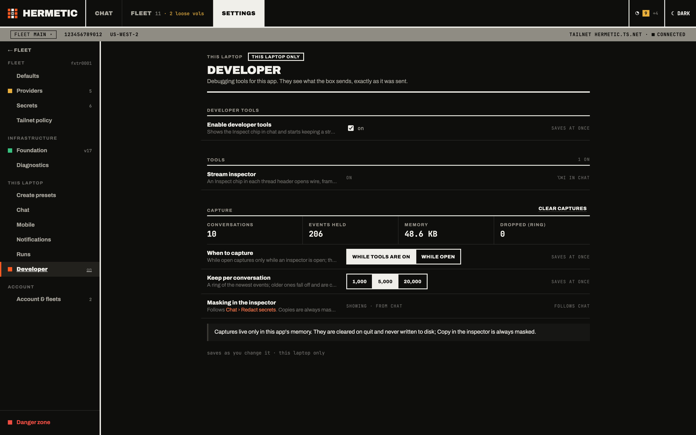

import { Aside } from "@astrojs/starlight/components";
import { Image } from "astro:assets";
import timing from "../../assets/powertools/inspector-timing.png";

hermetic shows its own work. The **stream inspector** in the desktop app lets you watch a chat turn travel from the agent's box to your screen, one message at a time. A handful of CLI commands look inside the **box itself**: its history, Hermes's own log files and its serial console. If what you see makes you want to change something, the last section shows where to start as a [contributor](#become-a-contributor).


## The stream inspector

{/* design.md §9.2 "Developer tools" */}
A chat transcript shows where a turn ended up. The inspector shows how it got there: every message the box sent, the frames the app built from each one, and what the chat view did with them. It keeps that record for each conversation and lets you read it next to the chat.

It is off by default and ships in every build of the app, including stable releases. Nothing about it depends on a developer build, so you can switch it on in the installed app and watch your own agents live.

### Turn it on

{/* design.md §9.2: Settings › This laptop › Developer, three prefs rows on this laptop */}
Open **Settings › This laptop › Developer** and check **Enable developer tools**. These settings belong to this laptop only; they are not shared with the rest of the fleet.



| Setting | Choices | What it does |
|---|---|---|
| When to capture | **While tools are on** (default), **While open** | While tools are on, every conversation is recorded, so you can open the inspector on a turn that already finished. While open records a conversation only while an inspector is showing it. |
| Keep per conversation | 1,000, **5,000** (default), 20,000 | The size of each conversation's ring of records. A full ring drops its oldest record and counts it under **Dropped (ring)**. |
| Masking in the inspector | follows **Chat › Redact secrets** | See [What it keeps, and where](#what-it-keeps-and-where). |

The page also shows how many conversations are being captured, how many records are held and roughly how much memory they use. **Clear captures** empties every ring at once. Turning the tools off does the same.

### Open it

{/* design.md §9.2 "In the page": entry points, all hidden while the tools are off */}
Every entry point is hidden while the tools are off, and each one has a dashed border so you can tell developer controls apart from the rest of the app.

- The dashed **`{ } Inspect`** chip in a conversation's header.
- <kbd>⌥⌘I</kbd> toggles the inspector for the conversation in focus.
- **Inspect message** in a message's hover actions opens the inspector filtered to that message.
- The **`{ }`** button in the agent drawer's chat opens the full chat view with the inspector open.
- In the Command-K palette, the `>` commands **Inspect stream** and **Open Settings › Developer**.

The inspector opens as a resizable split on the right of the full chat view.

### What it shows

{/* design.md §9.2 "What a record is" and "In the page" */}
Four tabs read the same conversation's capture:

- **Wire**: every JSON-RPC message read from or written to the Hermes chat socket on the agent's box, in order, with its arrival time, `seq` and size. Bursts of streaming deltas collapse into one row (`message.delta ×49`).
- **Frames**: what the app built from those messages, and what the chat view did with each one: a new block, a block replaced by a newer version, a delta appended, a frame dropped as a duplicate or for arriving out of order, or a block replaced when history was re-read.
- **State**: the blocks the chat view holds for each message, and every earlier version it replaced.
- **Connection**: the socket's life: dial, open, close, session create and resume, reconnect and replay.

A turn driven from somewhere else (Hermes Desktop, the CLI, another laptop) never passes through this laptop's socket, so it shows up only as what the app *observed*: history re-reads and status changes.

Select a row to read it in the detail pane:

| Pane | What it shows |
|---|---|
| **Raw** | The message as received, masked as described below. |
| **Lineage** | The path one message took: the wire message, the frames the app derived from it, and what the page did with each. |
| **Diff** | Field by field, what the app kept, renamed, dropped or added on the way from the wire message to its frame. |
| **Ids & timing** | Record id, arrival time, time since the previous record, layer and direction, socket, `seq`, parent record, size as received, and the conversation. |

<Image src={timing} width={420} densities={[1, 2]} alt="The inspector on its own. A message.delta ×49 row is selected, and the Ids & timing pane lists its record id, arrival time, 41 ms since the previous record, the layer (wire, box to laptop), its seq, 162 bytes as received, the conversation and the frame it became." />

### Each message has a fate

{/* design.md §9.2 "A wire record's fate" */}
Every wire message records what became of it:

| Fate | Meaning |
|---|---|
| `frames` | It produced that many frames. Each frame names the message it came from, which is how Lineage is drawn. |
| `drop` | It was read and discarded, with a reason: `internal` (an event Hermes Desktop also consumes without drawing) or `replay` (a `seq` the app had already handled, from the catch-up after a reconnect). |
| `buffer` | It was held and folded into a later frame, as reasoning or as media. |
| `none` | It was read and acted on with nothing to draw, such as a status or an acknowledgement. |

A fate is often settled after the message arrives, so a row can update in place while you watch.

### Find the row you want

{/* design.md §9.2 "In the page": toolbar, toggles and filter */}
The toolbar has **Pause**, **Clear** and **Copy**. The toggles are **Collapse deltas**, **Show dropped**, **Show frames under events**, **Group by turn** and **Follow**. The filter box takes free text and three kinds of term, which combine:

```
seq:52          one sequence number
fate:drop       only messages that were dropped
type:tool       only tool events
```

The chips under the filter (text, reasoning, tool, approval, activity, usage, rpc, internal) narrow the list by event kind.

### What it keeps, and where

{/* design.md §9.2 "Off means absent, and the capture lives in memory only" and "Masking follows Chat › Redact secrets" */}
The capture lives only in the desktop app's memory. It is never written to disk, never reaches the app's log file or the runs table, and is gone when the app quits. While the tools are off, the app captures nothing at all.

Masking follows **Settings › This laptop › Chat › Redact secrets**:

- With redaction on, a message is masked *before* it is stored, so the ring never holds the secret.
- With redaction off when a message arrives, it is stored as received, and masked when you read it if redaction is on by then.
- **Copy** is always masked, whatever the setting, because the text leaves the app.
- Four things are masked whatever the setting: the dashboard session token, the session token the app reads from the box (the inspector notes only that one was found), credential headers such as `authorization` and `cookie`, and error payloads, which can quote the request that failed.

<Aside>
The inspector is a view over the desktop app's own session, so it has no CLI command: a separate `hermetic` process would have nothing to read.
</Aside>

## Look inside a box

The inspector covers the chat path. The CLI reads each agent's machine directly, and every command below works the same against any agent in the fleet; the [CLI reference](/docs/reference/cli/) has every flag.

### An agent's history

{/* design.md §4.2 the append-only events table and `events.log_tail` */}
```
hermetic agent history atlas
```

An agent's history is its append-only event log: its status changes and boot stages, from its first boot on. Boot stages report as they run, and a stage that stops early carries the last 120 lines of its log, redacted on the box before it was recorded. The app's agent drawer shows the same timeline. Add `--json` for the raw fields.

History outlives the machine. `hermetic agent destroyed` lists destroyed agents, and `hermetic agent history <name>` still reads the log for a name you already destroyed. [Day to day](/docs/operate/day-to-day-ssh-logs-rerun/) in the runbook covers how boot stages resume.

### Hermes's own logs

{/* design.md §9 `logs --file`: Hermes's own log files under $HERMES_HOME/logs/ */}
```
hermetic logs atlas --file agent
```

Hermes keeps its own log files on the agent's data volume, separate from the systemd journal. `--file` reads one of them: `agent`, `errors` or `gateway`. Add `-f` to follow it live. Without `--file`, `logs` streams the journal for the agent's hermetic services.

### The serial console

```
hermetic logs atlas --console
```

`--console` reads the instance's serial console from AWS, from the moment the machine starts, before any service on it is running.

### What this laptop ran

{/* design.md §4.6 the local `runs` table; §9.2 app.log records a failed request's code and message */}
```
hermetic runs --last
```

`runs` is the local log of commands this laptop ran, with their output, shared by the CLI and the app's **Runs** view. The desktop app also writes every operation and request outcome to `~/.hermetic/app.log`, so the record is there after the window is closed.

## Become a contributor

{/* LICENSE (MIT); CONTRIBUTING.md, docs/architecture.md and docs/design.md in the repository */}
hermetic is open source under the MIT license, and everything on this page is a good way to learn how it fits together before you change it. The inspector shows the chat path one message at a time; the CLI shows what each box is doing. The repository has the rest:

- [README](https://github.com/esopian/hermetic#readme): setting up a checkout and running the app from source.
- [CONTRIBUTING.md](https://github.com/esopian/hermetic/blob/master/CONTRIBUTING.md): the toolchain, the tests and how releases are cut.
- [Architecture](https://github.com/esopian/hermetic/blob/master/docs/architecture.md): the packages and how they talk to each other.
- [Design spec](https://github.com/esopian/hermetic/blob/master/docs/design.md): how hermetic behaves, and the reference every change is held to.
